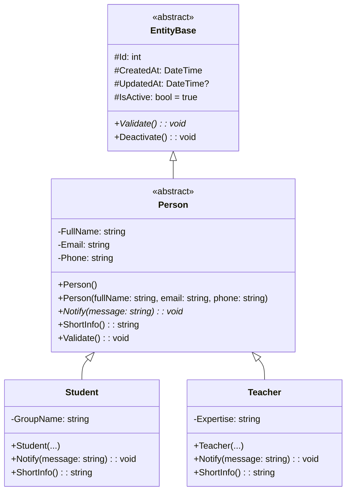
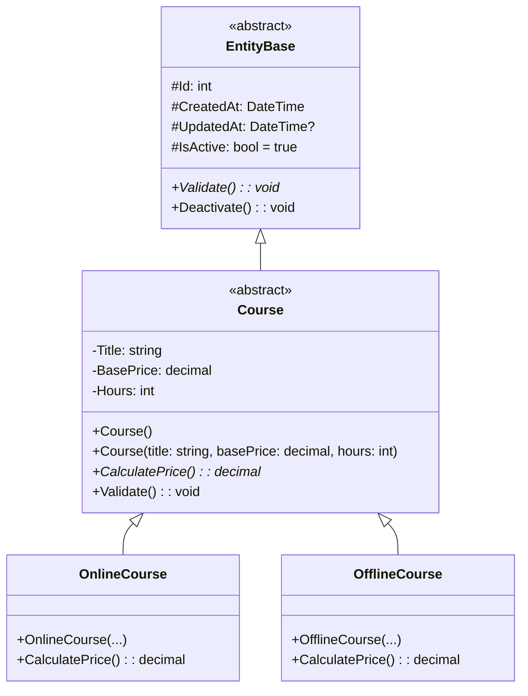
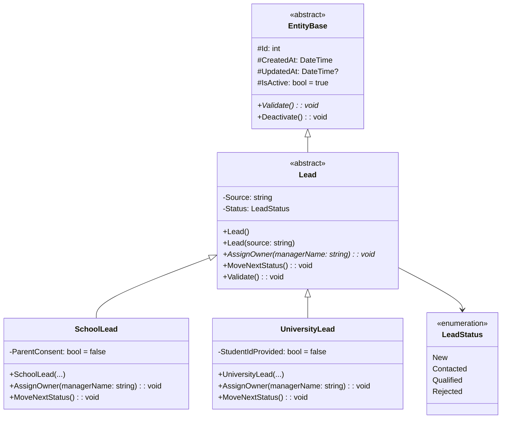
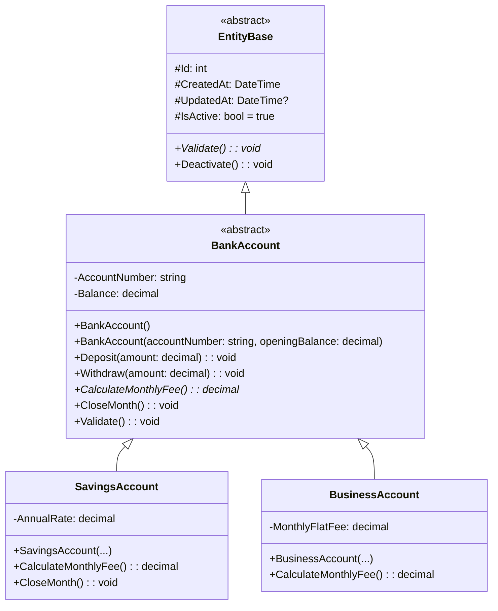
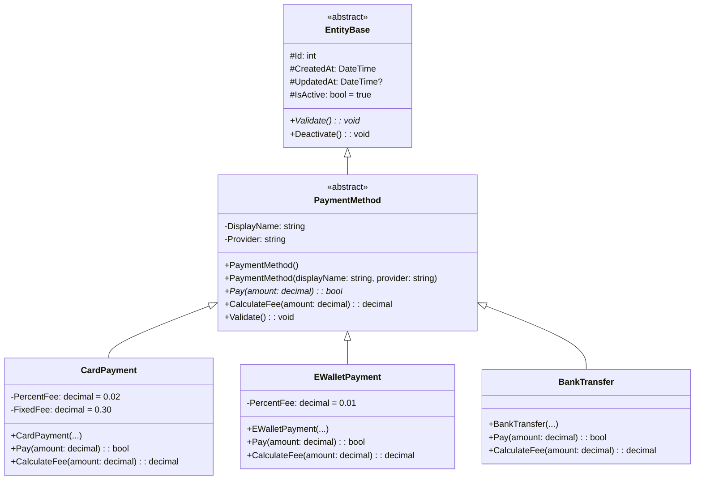

# Как оформить базовый класс сущностей

Рекомендуемый `EntityBase` (для обоих доменов):

```csharp
public abstract class EntityBase
{
    public int Id { get; protected set; }
    public DateTime CreatedAt { get; protected set; } = DateTime.UtcNow;
    public DateTime? UpdatedAt { get; protected set; }
    public bool IsActive { get; protected set; } = true;

    // Обязательная доменная проверка
    public abstract void Validate();

    // Общая логика
    public virtual void Deactivate()
    {
        IsActive = false;
        UpdatedAt = DateTime.UtcNow;
    }
}
```

---

# Задания

## Task 1. EdTech CRM — Базовый человек и роли

- Создайте `abstract class Person : EntityBase` со свойствами: `FullName`, `Email`, `Phone`.
- Добавьте `abstract void Notify(string message);` и `override Validate()` (проверка Email/FullName).
- Реализуйте два наследника:
  - `Student : Person` (добавьте `GroupName`, реализация `Notify` — имитация письма студенту).
  - `Teacher : Person` (добавьте `Expertise`, `Notify` — другое сообщение).
- Добавьте общий метод в `Person`: `public virtual string ShortInfo()` — возвращает краткое описание, пусть наследники переопределят.
- Продемонстрируйте: полиморфный список `List<Person>` и вызов `Notify`/`ShortInfo()`.

> Критерии: абстрактные члены реализованы, валидация работает, полиморфизм показан.



---

## Task 2. EdTech CRM — Курсы и форматы обучения

- Создайте `abstract class Course : EntityBase` со свойствами: `Title`, `BasePrice`, `Hours`.
- Добавьте `abstract decimal CalculatePrice();` и `override Validate()` (непустой `Title`, `Hours > 0`).
- Наследники:

  - `OnlineCourse : Course` — цена = `BasePrice` − 10% (нет аренды).
  - `OfflineCourse : Course` — цена = `BasePrice` + 15% (аренда, материалы).

- Добейтесь, чтобы клиентский код работал через `List<Course>` и корректно считал цены.

> Критерии: корректные формулы, единый интерфейс, валидации.



---

## Task 3. EdTech CRM — Заявки/лиды и конверсия

- Создайте `abstract class Lead : EntityBase` со свойствами: `Source`, `Status` (enum: New, Contacted, Qualified, Rejected).
- Методы: `virtual void MoveNextStatus()`, `abstract void AssignOwner(string managerName)`, `override Validate()`.
- Наследники:

  - `SchoolLead` (школьники): при `MoveNextStatus` добавляйте правило (например, нужна согласие родителей).
  - `UniversityLead` (студенты): другие правила перехода.

- Покажите различия поведения при одинаковом вызове `MoveNextStatus()`.

> Критерии: разный доменный флоу, общий контракт.


---

## Task 4. FinTech — Базовый банковский счёт

**Цель:** абстрактный класс с общей реализацией и абстрактным «крючком».

- `abstract class BankAccount : EntityBase`

  - Свойства: `AccountNumber`, `Balance`.
  - Методы: `Deposit(decimal amount)` (общий), `Withdraw(decimal amount)` (общий с проверками),
    `abstract decimal CalculateMonthlyFee()`.
  - Метод-шаблон `public virtual void CloseMonth()`:

    - списывает комиссию `CalculateMonthlyFee()`,
    - обновляет `UpdatedAt`.

- Наследники:

  - `SavingsAccount` — низкая комиссия, начисление % (можно в `CloseMonth` дополнительно).
  - `BusinessAccount` — фиксированная/повышенная комиссия.

- Проверьте поведение через единый интерфейс `BankAccount`.

> Критерии: шаблонный метод, корректные балансовые операции, проверки.


---

## Task 5. FinTech — Платежные методы и комиссия

**Цель:** контракты + полиморфизм для разных провайдеров.

- Создайте `abstract class PaymentMethod : EntityBase`

  - Свойства: `DisplayName`, `Provider`.
  - Методы: `abstract bool Pay(decimal amount);`
  - Хук: `public virtual decimal CalculateFee(decimal amount)` (по умолчанию 0).

- Наследники:

  - `CardPayment` — комиссия 2% + фикс (например, 0.3).
  - `EWalletPayment` — комиссия 1%.
  - `BankTransfer` — комиссия 0, но задержка (смоделируйте логом).

- Покажите обработку списка `List<PaymentMethod>`: сумма к оплате = `amount + fee`, вызов `Pay`.

> Критерии: разная комиссия, единый контракт, корректные расчёты.


